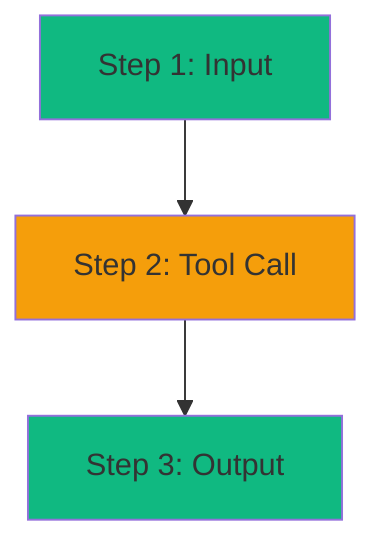

# Trace Analyzer

Orchestrate a Langfuse trace analysis loop: fetch live observations/scores, compare against a baseline session export, and emit a JSON graph, Mermaid flowchart, and differential validation scorecard.

The analysis loop is guarded by a pre-flight step that validates graph topology (ingress edge/node check and count) and runs a graph mutation test before any live telemetry is fetched, baseline data is loaded, or artifacts are emitted.

## When to Use
- User types `/trace-analyze --id <trace_id> --baseline <filepath>`
- User asks to analyze a Langfuse trace against a baseline export

## Prerequisites
- Node.js and npm installed (`node --version`, `npm --version`)
- Langfuse credentials configured (environment variables or `~/.langfuse/.env`)
- Baseline export JSON file exists at the provided `--baseline` path

## Invocation

The skill receives two arguments from the slash command:
- `--id <trace_id>` — the live Langfuse trace ID to inspect
- `--baseline <filepath>` — path to a local Langfuse session export JSON

Example:
```
/trace-analyze --id abc-123 --baseline C:\Users\vboxuser\langfuse_validation_report.json
```

## Procedure

### Step 0: Ingress Edge/Node Pre-flight Check and Graph Mutation Test

> Run this step before any other analysis. No live telemetry is fetched, no baseline data is loaded for comparison, and no artifacts are generated until Step 0 passes. If Step 0 reports any structural discrepancy, the agent must record it in the report and may either halt or continue with the discrepancy visible — never silently proceed.

#### 0.1 Ingress Node and Edge Check

Inspect the baseline graph and compute: first unwrap the export — if the file is a raw CLI envelope (`{status, headers, body: {data, meta}}`), use `body.data` as the observation list; otherwise use the top-level `traces`/observations array. Record an envelope-vs-traces-array discrepancy when no top-level array exists. Then compute:

- **Node count**: total number of observation nodes in the baseline graph.
- **Edge count**: total number of directed edges connecting pairs of nodes.
- **Ingress count**: number of nodes with zero incoming edges (entry/root points).
- **Egress count**: number of nodes with zero outgoing edges (exit/leaf points).
- **Graph shape indicators**: whether the graph is a single connected DAG, and whether it contains self-loops or duplicate edges.
- **External/missing parents**: count of nodes whose `parentObservationId` is not in the baseline node set (these become ingress nodes); record as a discrepancy and note the connected-component count.

Report Step 0 counts as session-level topology context only. They are not the scorecard's Node Sequence Count target; the scorecard compares the live trace against baseline observations filtered by the same `traceId` (Step 3). The deviation column shows the live-vs-baseline count difference for that target trace. If the baseline graph is malformed (not a JSON array of observations, missing `name`/`type`, or node/edge arrays absent), record the discrepancy as a hard error and halt — do not proceed to live telemetry.

#### 0.2 Graph Mutation Test

Apply a single controlled mutation to a working copy of the baseline graph, then verify the mutation is detected:

- **Mutation set** (agent selects ONE, default `node-removal` at the last leaf that has an incoming edge within the baseline graph): `{node-removal, edge-rewire, node-duplication}`. If no leaf has an incoming edge, use `node-duplication` or `edge-rewire` instead so the expected edge delta is non-zero.
- **Mutation application**: apply the mutation to the working copy and recompute ingress/egress counts on the mutated graph.
- **Discrepancy check**: the mutated graph must produce a different ingress count or edge count from the baseline counts. Verify the difference equals the expected delta (e.g., removing a leaf reduces the edge count by 1 and changes the egress count by -1).
- **Verification pass/fail**: PASS if the computed delta matches the expected delta; FAIL otherwise. Record the mutation type, the injected discrepancy, the expected delta, and the actual delta in the report.

#### 0.3 Discrepancy and Limitation Statement

After Step 0, emit a short discrepancy statement that lists every structural anomaly found (missing baseline array, envelope-vs-traces-array mismatch, trace absent from baseline, external/missing parent references, zero ingress nodes, mutation-test failure). This statement is included in the report and the scorecard's Node Sequence Count row shows the live-vs-baseline count difference.

> **Discrepancy rules:** A graph with zero ingress nodes is a cycle (report as `❌ CYCLE DETECTED`); a malformed baseline is a hard error (halt); a mutation-test FAIL is a structural integrity warning (continue to analysis but flag the discrepancy in the scorecard).

### Step 1: Fetch Live Telemetry

Run both commands in parallel via `terminal` with `background=false` so the agent can capture stdout:

```bash
npx @langfuse/cli api observations list --trace-id <trace_id> --json
```

```bash
npx @langfuse/cli api scores list --trace-id <trace_id> --json
```

If either command fails (non-zero exit or missing CLI), stop and report the error.

> **Pitfall:** A zero exit code with `body.data: []` is NOT a successful analysis — it means the live API returned no observations for that trace. Treat empty live results as a runtime mismatch. Populate the graph nodes from baseline data with `status: live-missing`, and report the count deviation in the scorecard rather than silently producing empty artifacts.

### Step 2: Load Baseline

Read the file at `--baseline` using `read_file`. Parse it as JSON. If it is a raw CLI envelope, unwrap `body.data` before treating it as the observation list and record that discrepancy.

### Step 3: Compute & Compare

1. **Golden sequence template:** Filter the baseline observations to those with `traceId == <trace_id>` (the export is an observation list, not a top-level `traces` array). Each entry is an observation with `name`, `type`, `startTime`, `endTime`, and `latency`.
2. **Sequence check:** Compare the live observation execution order against the baseline template. Mark any out-of-order steps. If live observations are empty but the baseline contains entries for this trace, the sequence count is a mismatch. If the baseline contains no entries for this trace, record a trace-absent discrepancy instead of borrowing unrelated traces' observations.
3. **Latency check:** If live observations are present, calculate live trace total latency (use the root observation's `latency`, equivalently the maximum `latency` among live observations, since child spans are nested within it) and compare against the maximum latency in the baseline export. If live observations are empty, report `N/A` for status and show the baseline maximum as the Independent Record Target so the gap is visible.
4. **Cost check:** Observation-level exports do not include token/cost fields. If neither live nor baseline observations carry `totalPrice`, `inputPrice`, `outputPrice`, or equivalent token counts, report `N/A` in the scorecard instead of fabricating a comparison. In that case set Live Trace Value and Independent Record Target to `N/A`, Status to `✅ PASS`, and Runtime Deviation to `N/A`.

### Step 4: Emit Artifacts

Emit exactly three artifacts in the final response:

#### 1. JSON Graph (Machine-Readable Topology)

Provide a raw JSON code block with this shape:

```json
{
  "trace_id": "<trace_id>",
  "nodes": [
    { "id": "step-1", "name": "Tool Call", "type": "tool", "latency_ms": 120, "status": "match" }
  ],
  "edges": [
    { "from": "step-1", "to": "step-2", "status": "ordered" }
  ]
}
```

- `nodes` must include every observation from the live trace. If the live API returned empty results and the baseline contains observations for this trace ID, populate only those matching observations with `status: live-missing`. If the baseline has no observations for this trace ID, emit an empty `nodes` array and record a trace-absent discrepancy; do not reuse unrelated traces' observations.
- `edges` must reflect the execution order.
- `status` values: `match`, `out-of-sequence`, `dynamic-runtime`, `live-missing`.

#### 2. Mermaid Flowchart (Visual Depiction)

Provide a vertical `graph TD` Mermaid flowchart.

Color-code nodes using inline styles:
- **Emerald Green `#10B981`** — matches session export template
- **Crimson Red `#EF4444`** — out of sequence / threshold failure / live data missing for a trace present in baseline
- **Amber Orange `#F59E0B`** — dynamic runtime tool call

Example:


#### 3. Validation Scorecard (Differential Metric Report)

Provide a Markdown table with these exact columns:

| Metric Vector | Live Trace Value | Independent Record Target | Status | Runtime Deviation |
|---|---|---|---|---|
| Node Sequence Count | [count] | [count] | ✅ MATCH / ❌ MISMATCH | [difference] |
| Execution Latency | [seconds] | [max seconds] | ✅ PASS / ❌ REGRESSION | [deviation] |
| Token Cost Barrier | [cost] | [max cost] | ✅ PASS / ❌ OVER-BUDGET | [deviation] |

End with this explicit label on its own line:

```
Overall Execution Validation State [OPTIMAL | ATTENTION REQUIRED | REGRESSION THRESHOLD BREACHED]
```

Choose the label based on the worst individual status:
- All `✅ MATCH` / `✅ PASS` → `OPTIMAL`
- Any `❌ MISMATCH` or `❌ REGRESSION` → `ATTENTION REQUIRED`
- Any `❌ OVER-BUDGET` with significant deviation → `REGRESSION THRESHOLD BREACHED`

Append the Step 0 discrepancy statement (from 0.3) below the scorecard as a `### Discrepancies Found` subsection. List each discrepancy as a bullet with its type, severity, and recorded value.

## Step 5: Write Artifacts to Disk

Write the three emitted artifacts to files in the **same directory** as the baseline export JSON. Use these filenames, replacing `<trace_id>` with the live trace ID:

- `trace_graph_<trace_id>.json` — the JSON graph
- `trace_flowchart_<trace_id>.mmd` — the Mermaid flowchart
- `trace_scorecard_<trace_id>.md` — the validation scorecard (includes the Discrepancies subsection)

Write each file using `write_file`.

### Step 5.1: Visualize in the Final Response

In addition to writing the files above, present the JSON graph and the Mermaid flowchart inline in the final response as fenced code blocks so they render as visualizations (machine-readable topology and flowchart). Do not omit them from the chat even though the files exist on disk; the files are the durable record, the inline blocks are the visualization.

## Pitfalls

- Argument tokens may be glued to their flags (e.g. `--id<value>`); split on the next `--` or end of input rather than requiring whitespace.
- If `--baseline` does not exist as given and has no extension, retry with `.json` appended.
- Step 0 is session-level: operate on the entire unwrapped baseline observation set. Node/edge/ingress/egress counts, graph shape, and the mutation test describe the whole export, not the target trace.
- Per-trace work in Step 3 must filter baseline observations by `traceId == <trace_id>`; never borrow observations from other traces, even when the target trace is absent.
- Step 0 whole-graph counts are pre-flight context only; do not use them as scorecard targets or as the target trace's independent record count.
- "Last leaf" for the default mutation means the last leaf in baseline observation-list order that has an incoming edge; choose one whose parent has more than one child so removal changes egress by -1 as expected.
- The latency independent record target is the maximum `latency` across all baseline observations, not only the target trace.
- `scores list` may return `body.data: []`; treat that as no scores and report cost as `N/A`.
- Status assignment: mark TOOL-type observations as `dynamic-runtime` (amber) and CHAIN/GENERATION observations that are present in the baseline template and in correct order as `match` (emerald); reserve `out-of-sequence` for template members in the wrong position and `live-missing` for baseline members absent from live.
- When a root observation has multiple child observations that execute sequentially, chain edges in `startTime` order (root → first child → …); emitting every child as a direct child of the root records containment only and loses execution order.
- The observations API (and the baseline export) return entries in non-chronological order (often reverse or insertion order); sort both live and baseline observations by `startTime` before deriving execution order or chaining edges. Array order is not execution order.
- External parent ids may be shared by many observations (for example, one missing root with many children): count affected *nodes* for the external/missing-parent discrepancy and report the distinct parent-id count separately. Compute connected components on internal edges; do not infer components from ingress or external-parent counts.
- When several observations share a missing parent, they are not connected to each other; only parent/child links present in the export create edges.
- In Mermaid, quote labels containing parentheses, colons, or spaces (e.g. `A["Hermes turn (CHAIN)"]`).

## Verification

After computing, verify:
- The JSON graph block parses as valid JSON.
- The Mermaid `graph TD` block contains only supported node/edge syntax.
- The scorecard table has exactly 5 columns and 3 data rows (header + separator + 3 data rows = 5 pipe-prefixed lines total).
- The final status label matches one of the three allowed values.
- All three artifact files exist on disk in the baseline directory, are non-empty, and the `.json` artifact parses as valid JSON.
- The Step 0 discrepancies list (if any) is present and each discrepancy has a recorded type, severity, and recorded value.
